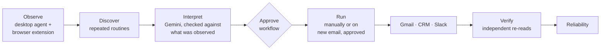

# WorkFlowOS

[](https://github.com/Sujalranjan/WorkFlow-OS/actions/workflows/ci.yml)

WorkFlowOS watches the routine work you do across apps, finds the parts you repeat, turns them into a workflow you approve, and then runs that workflow for you through real integrations (Gmail, a CRM, Slack), with a dry run first. After that, an email trigger queues a run for each new matching email. You approve each run, and a run stops to ask you whenever it can't decide safely (for example, an unknown customer).



Details: [docs/architecture.md](docs/architecture.md) · setup and configuration: [docs/development.md](docs/development.md).

## How observation becomes execution

The **Action Catalog** ([backend/app/services/action_catalog.py](backend/app/services/action_catalog.py)) is the fixed list of actions WorkFlowOS can actually perform:

| Catalog action | Observed as | Executor | Risk |
|---|---|---|---|
| `gmail.search_email` | Gmail search route `#search/<query>` | GmailApiExecutor (read-only) | low |
| `gmail.download_attachment` | completed download from Gmail | GmailApiExecutor → sandbox | medium |
| `crm.find_customer` | CRM page `/ui/customers/<id>` or `?q=` | CrmApiExecutor | low |
| `crm.update_customer_record` | CRM form submit (status field) | CrmApiExecutor | high, confirmation required |
| `slack.send_notification` | message sent in `app.slack.com/client/<team>/<channel>` | SlackApiExecutor | medium |

- Events are classified deterministically (URL and metadata rules, with no LLM involved). A classified event becomes a DNA step such as `gmail:search_email` with `catalog_action` set. Its parameters (search query, customer, status, channel) become DNA variables.
- The LLM only describes the workflow. It cannot rename, drop or re-route an executable step: the validator rejects output that omits one, and the spec takes action names and risk levels from the catalog.
- Steps with no catalog match (for example window focus) stay in the spec as context. The plan records them as excluded and never executes them.
- Parameters that changed between observed runs (such as the customer) are **never** filled in from a past run. They come from upstream outputs (`customer_query ← sender of the selected email`) or must be supplied at run time.
- Each step is routed to exactly one named executor. Risk policy, the human approval gate and fail-closed execution still apply: a failed **or blocked** step stops the run.

## Repository layout

```
backend/            FastAPI backend: pipeline services, executors, verifiers, Demo CRM (+ browser UI)
desktop-agent/      Windows window/file collectors, event queue, demo scripts
  browser_extension/  Chrome/Edge extension that reports Gmail/CRM/Slack actions
frontend/           React + TypeScript dashboard (pages/, components/, api.ts)
tests/              pytest suite (isolated: never touches your databases or live services)
docs/               Architecture and development notes
```

## Run with Docker

```bash
docker compose up --build
```

This starts the API (http://localhost:8000/docs), the Demo CRM (http://localhost:8001/ui/customers) and the dashboard (http://localhost:5173). Data is kept in the `workflowos-data` volume.

- Create the first admin (there is no sign-up page; admins add everyone else in **Settings**):
  ```bash
  docker compose exec api python -m app.cli create-user --email you@example.com --name "Your Name" --role admin
  ```
- Integrations are read from `.env` if it exists (copy `.env.example`).
- For Gmail, create `token.json` on your machine first (the sign-in opens a browser, so it can't run inside a container), then put `credentials.json` and `token.json` in a `secrets/` folder next to `docker-compose.yml`.
- The desktop agent and browser extension run on your machine and report to `http://localhost:8000` as usual.
- Logs are JSON, one object per line, with a `request_id` that is also returned in the `X-Request-ID` response header: `docker compose logs -f api`.

## Run locally


```bash
pip install -r backend/requirements.txt -r desktop-agent/requirements.txt
```

1. **Backend** (port 8000):
   ```bash
   python -m uvicorn app.main:app --host 127.0.0.1 --port 8000 --app-dir backend
   ```
2. **Demo CRM** (port 8001, API at `/api/crm`, browser UI at `http://127.0.0.1:8001/ui/customers`):
   ```bash
   python backend/app/crm_server.py
   ```
3. **Frontend**:
   ```bash
   cd frontend && npm install && npm run dev
   ```
4. **First admin** (asks for a password of at least 12 characters), then sign in at http://localhost:5173:
   ```bash
   python backend/app/cli.py create-user --email you@example.com --name "Your Name" --role admin
   ```
5. **Observe real activity.** In **Settings → API keys**, create a key. The agent and extension can only *send* activity with it.
   - Desktop agent (window focus and file events): set `WORKFLOWOS_API_KEY` in `.env`, then `python -m desktop_agent.agent` with `PYTHONPATH=".;backend;desktop-agent"`.
   - Browser extension: open `chrome://extensions`, enable Developer mode, choose *Load unpacked* and pick `desktop-agent/browser_extension`. In its options page, set the backend URL and paste the key.

   Then do the routine by hand a few times (at least 2 sessions, separated by 2+ minutes of inactivity).

No real activity yet? On the **Activity** page, click **Load sample activity** (or call `POST /api/demo/seed-activity` with `{"scenario": "observed_browser_routine"}`). That loads three recorded sessions of a Gmail → CRM → Slack routine.

### Using the dashboard

Open `http://localhost:5173`. The sidebar follows the life of a workflow:

| Page | What you do there |
|---|---|
| **Overview** | See which integrations are connected, a getting-started checklist, and anything waiting for you. |
| **Activity** | See what was recorded. Under *Repeated routines*, click **Create workflow** on a routine (e.g. *Gmail → CRM → Slack, seen 3 times*). |
| **Workflows** | Review each step and what it changes, then **Approve** or **Reject**. An approved workflow can be tried with **Test run** (changes nothing) or run with **Run now**. Its reliability appears after it has run. |
| **Inbox** | Approve emails picked up by a trigger, and answer runs that paused (for example, choose which CRM customer an email is about). |
| **Automations** | Create email triggers that start a workflow when a matching email arrives. |
| **Runs** | Every run, step by step, and whether the result was verified afterwards. |
| **Settings** (admins) | Add people and set their role; create and revoke API keys for the agent and extension. |

**Roles:** *viewers* see everything; *approvers* can also create, approve and run workflows and answer paused runs; *admins* can also manage email triggers, users and API keys. Approvals and runs record who did them.

Without `GEMINI_API_KEY`, routines are described by built-in rules from what was observed; with a key, Gemini writes the description and its output is checked against the observation before use.

### Automate it: email triggers

Once a workflow that starts with a Gmail search is approved, open **Automations** and create an email trigger with a Gmail query (for example `subject:"Customer Replacement Request" has:attachment`).

- While the backend runs, it checks Gmail on the trigger's interval (default 60 s, minimum 30 s; read-only). Every new matching email appears in the **Inbox** as a run waiting for approval. Nothing runs until you approve it.
- **Approve & run** executes the workflow for that exact email: the attachment download uses that email's message id, never "the newest match". The run is then verified and fed into the reliability profile.
- If the CRM has no customer for the sender, or several possible ones, the run **pauses** and asks you to pick the customer. It then continues from that step. **Cancel run** stops it instead.
- **Check now** polls immediately. A trigger only considers emails received after it was created, unless you choose a look-back window.
- API: `/api/automation/triggers` and `/api/automation/runs` (see `/docs`). Set `TRIGGER_POLLER_ENABLED=false` to turn off background polling.

### Integrations

| Service | Configure | Notes |
|---|---|---|
| Gemini (optional) | `GEMINI_API_KEY`, `GEMINI_MODEL` in `.env` | Without a key an offline deterministic interpreter is used |
| Gmail (read-only) | `credentials.json` (OAuth client) + `GMAIL_ENABLED=true` | Sign in: `python scripts/gmail_login.py` (`--force` to replace an expired sign-in) |
| Slack | `SLACK_BOT_TOKEN`, `SLACK_CHANNEL_ID` | Bot needs `chat:write` (+ `channels:history` for verification) |
| CRM | `CRM_API_BASE_URL`, `CRM_WEB_BASE_URL` | Defaults to the bundled Demo CRM on port 8001 |

Environment variables take precedence over `.env`. Never commit `.env`, `credentials.json` or `token.json` (they are git-ignored).

## Tests

```bash
# PowerShell: $env:PYTHONPATH=".;backend;desktop-agent"
PYTHONPATH=".;backend;desktop-agent" pytest tests -q
```

CI ([.github/workflows/ci.yml](.github/workflows/ci.yml)) runs this suite, type-checks and builds the frontend, and builds and starts the Docker stack on every push and pull request.

Each test session uses a throwaway database, CRM database and sandbox, and strips secrets from the environment. Tests that call real Gemini, Slack or Gmail are marked `live` and skipped unless you opt in with `WORKFLOWOS_LIVE_TESTS=1`.

The observation-to-execution bridge is covered by [tests/backend/test_observed_to_execution.py](tests/backend/test_observed_to_execution.py) and [tests/backend/test_observed_to_execution_api.py](tests/backend/test_observed_to_execution_api.py). They feed recorded browser sessions through the whole pipeline, check that the discovered workflow matches the reference spec in [reference_workflow.py](backend/app/services/reference_workflow.py), and then execute and verify it.

## Adding a new executable action

1. Add a `CatalogAction` to `ACTION_CATALOG` (executor name, risk, parameters, outputs).
2. Teach `classify_event()` how the action looks when a person does it (URL pattern, download source, form submit).
3. Make sure the executor declares the action in `supported_actions`. If needed, map its outputs to context keys in `ExecutionEngine`.
4. Add a classification test and extend the recorded-session tests.

More detail: [docs/architecture.md](docs/architecture.md), [docs/development.md](docs/development.md).

## License

[MIT](LICENSE)
