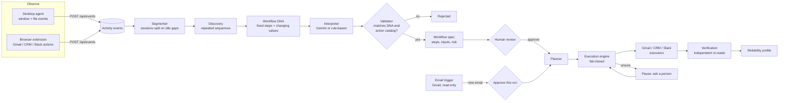

# Architecture

WorkFlowOS turns repeated manual work into approved, verified automations. Deterministic code decides what happened, what can run and whether it worked; the LLM only describes routines in human terms, and a person approves before anything changes.

## Components

| Area | Code | Responsibility |
|---|---|---|
| Observation | `desktop-agent/` | Windows window-focus and file collectors; MV3 browser extension for Gmail searches and downloads, CRM pages and updates, Slack sends. Sends structured `ActivityEvent`s, never page content, keystrokes or screenshots. |
| Discovery | `workflow_segmenter.py`, `workflow_discovery.py` | Splits events into sessions at idle gaps (120 s), filters incidental apps, and groups similar sessions with `difflib.SequenceMatcher` (similarity ≥ 0.65, at least 2 occurrences). |
| Workflow DNA | `workflow_dna_extractor.py` | For one repeated routine: steps present in every session, optional steps, values that change between sessions, ordering constraints, duration bounds and evidence. Ids derive from a SHA-256 of the step signature, so the same routine always gets the same id. |
| Action catalog | `action_catalog.py` | The fixed list of executable actions, each with exactly one executor, a risk level and its parameters. Observed events are classified into catalog actions by URL and metadata rules, with no LLM involved. |
| Interpretation | `semantic_provider.py`, `semantic_engine.py`, `semantic_validator.py` | Gemini (JSON output with a response schema) or, without a key, a rule-based interpreter. Output that names steps, applications or parameters absent from the DNA, or breaks its ordering, is rejected rather than repaired. |
| Specification | `canonical_factory.py`, `risk_analyzer.py` | Builds the reviewable workflow: catalog steps, parameter bindings and per-step risk. Starts in *requires review*; reuses the existing workflow for the same routine. |
| Planning | `execution_planner.py` | Only for approved workflows. Resolves each parameter: runtime input, then output of an earlier step (e.g. customer ← email sender), then an observed value only if it never changed. A value that differed between sessions is never copied from a past run. |
| Execution | `execution_engine.py`, `executors/`, `strategy_selector.py`, `execution_policy.py` | Runs steps in order through the catalog's executor, passing outputs forward (selected email id → attachment download → customer id → CRM update). A failed or blocked step stops the run; later steps are skipped, never attempted. Idempotency keys prevent repeated runs. |
| Intervention | engine + `crm_executor.py` | When a step cannot decide safely (no CRM customer, or several), it returns `NEEDS_INPUT`. The run pauses with its state saved and continues from that step once a person answers. Approval and policy are re-checked first. |
| Verification | `verification_engine.py`, `verifiers/` | After a run, re-reads each system independently: file size and SHA-256 for downloads, a fresh CRM `GET` for updates, Slack `conversations.history` for messages. *Executed* and *verified* are reported separately. |
| Learning | `learning_engine.py` | Reliability per workflow and step from execution and verification history, failure classification and suggestions. Advisory only: it never edits workflows or approvals. |
| Automation | `trigger_service.py`, `trigger_scheduler.py` | Email triggers poll Gmail on an interval (`(<query>) after:<created>`). Each new message becomes one run awaiting approval. The runs table is the processed-email ledger (`UNIQUE(trigger_id, message_id)`), and approval is a single conditional update, so a run cannot execute twice. |
| API and UI | `backend/app/api/`, `frontend/src/` | FastAPI (OpenAPI at `/docs`); React + TypeScript dashboard: Overview, Activity, Workflows, Inbox, Automations, Runs. |

## Integrations

| System | Operations | Notes |
|---|---|---|
| Gmail | search, fetch one message, download attachment | OAuth scope `gmail.readonly` only. Attachments are written to a per-run sandbox folder with path-traversal checks. |
| CRM | find customer, get customer, update status | Separate FastAPI service with its own database, reached over HTTP. Ships with a browser UI so the CRM step can be done, and observed, by hand. |
| Slack | post message, read channel history | Bot token; messages go to `SLACK_CHANNEL_ID`. |
| Gemini | describe a routine | Receives only the DNA summary (apps, step types, parameter names and sample values), never raw events. |

## Access control

- **People** sign in with email and password (Argon2id hashes). The session is a random token in an `HttpOnly`, `SameSite=Lax` cookie (`Secure` when `COOKIE_SECURE=true`); only its SHA-256 is stored, it expires after `SESSION_TTL_HOURS`, and changing a user's role or password, or disabling them, ends their sessions. Failed sign-ins are rate limited per email and per client address.
- **Roles** are ordered: viewer < approver < admin. Every API route is authorized by one app-wide dependency against `ROUTE_POLICY` in `security.py`; a route missing from that table is admin-only, and a test fails if any route is unlisted.
- **CSRF**: state-changing requests with the session cookie must carry the `X-WorkflowOS-CSRF` header, which cross-site forms cannot send; CORS only admits the dashboard's origin (`FRONTEND_ORIGINS`).
- **API keys** (`wfos_…`, SHA-256 stored, revocable) let the desktop agent and browser extension send activity events and nothing else.
- Approvals, run decisions and executions record the signed-in user, not a name supplied by the client.

## Safety model

- **Two decisions by a person**: approving the workflow, and approving each triggered run (manual runs ask for confirmation in the UI).
- **Dry run** simulates every step with zero external calls.
- **Fail closed**: missing credentials, unresolved parameters, policy blocks and executor errors stop the run with a reason.
- **No silent guesses**: ambiguous lookups pause for a person instead of picking a record.
- **Secrets** never appear in API responses, audit records, logs or LLM prompts; tests assert this.

## Observability

Logs are structured (JSON in Docker). Each API request carries an id from `X-Request-ID` (or a generated one) that is attached to every log line written while handling it, including outbound Gmail, CRM and Slack calls. Every execution keeps a full audit record: per-step parameters, outputs, errors, chosen executor and policy decision.

## Storage

SQLite: one database for WorkFlowOS (events, workflows, plans, executions, verifications, reliability, triggers and runs) and one for the Demo CRM. Records are stored as validated JSON next to indexed columns.

## Current limits

- Connection secrets (Gmail token, Slack token) are still read from files and environment variables rather than an encrypted store.
- Interpretations are cached in memory, so after a restart a routine is re-interpreted before a new workflow is created from it (existing workflows are unaffected).
- Only catalog actions execute; other observed activity is kept as context. Browser, accessibility and UI-automation strategies are modelled but have no executor.
- Gmail is polled, not pushed.
