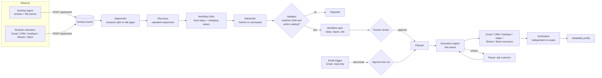

# Architecture

WorkFlowOS turns repeated manual work into approved, verified automations. Deterministic code decides what happened, what can run and whether it worked; the LLM only describes routines in human terms, and a person approves before anything changes.

## Components

| Area | Code | Responsibility |
|---|---|---|
| Observation | `desktop-agent/` | Windows window-focus and file collectors; MV3 browser extension for Gmail searches, downloads and labels, Demo CRM and HubSpot pages and updates, opened Google Sheets, Slack sends and thread replies. An optional second file collector watches the team's shared folder. Sends structured `ActivityEvent`s, never page content, keystrokes or screenshots. |
| Discovery | `workflow_segmenter.py`, `workflow_discovery.py` | Splits events into sessions at idle gaps (120 s), filters incidental apps, and groups similar sessions with `difflib.SequenceMatcher` (similarity ≥ 0.65, at least 2 occurrences). |
| Workflow DNA | `workflow_dna_extractor.py` | For one repeated routine: steps present in every session, optional steps, values that change between sessions, ordering constraints, duration bounds and evidence. Ids derive from a SHA-256 of the step signature, so the same routine always gets the same id. |
| Integrations | `app/integrations/` | One module per tool (Gmail, Demo CRM, HubSpot, shared folder, Google Sheets, Slack) declaring its catalog actions, the rules that recognise them in observed activity, its executor and verifier, and a status check. |
| Action catalog | `action_catalog.py` | Assembles the integrations' actions into the fixed list of executable actions, each with exactly one executor, a risk level and its parameters. Observed events are classified into catalog actions by URL and metadata rules, with no LLM involved. |
| Interpretation | `semantic_provider.py`, `semantic_engine.py`, `semantic_validator.py` | Gemini (JSON output with a response schema) or, without a key, a rule-based interpreter. Output that names steps, applications or parameters absent from the DNA, or breaks its ordering, is rejected rather than repaired. |
| Specification | `canonical_factory.py`, `risk_analyzer.py` | Builds the reviewable workflow: catalog steps, parameter bindings and per-step risk. Starts in *requires review*; reuses the existing workflow for the same routine. |
| Workflow editor | `workflow_editor.py`, `api/catalog.py` | Edits steps and inputs of an existing workflow as a new version (kept in `workflow_versions`). Checked against the catalog: declared parameters only, each step after the steps that `produce` what it `requires`, never a recorded value for an input that changed between runs. Saving resets approval; approvals name the version reviewed; writes are conditional, so concurrent edits and decisions cannot overwrite each other. |
| Planning | `execution_planner.py` | Only for approved workflows; a plan is tied to the version it was made from. For an edited step, each input is what the editor chose (a fixed value is never overridden at run time). Otherwise resolves each parameter: runtime input, then output of an earlier step (e.g. customer ← email sender), then an observed value only if it never changed. A value that differed between sessions is never copied from a past run. |
| Execution | `execution_engine.py`, `executors/`, `strategy_selector.py`, `execution_policy.py` | Runs steps in order through the catalog's executor, passing outputs forward (selected email id → attachment download → customer id → CRM update). A failed or blocked step stops the run; later steps are skipped, never attempted. Idempotency keys prevent repeated runs. |
| Intervention | engine + `crm_executor.py` | When a step cannot decide safely (no CRM customer, or several), it returns `NEEDS_INPUT`. The run pauses with its state saved and continues from that step once a person answers. Approval and policy are re-checked first. |
| Verification | `verification_engine.py`, `verifiers/` | After a run, re-reads each system independently: file size and SHA-256 for downloads and shared-folder copies, a fresh CRM or HubSpot `GET` for updates and notes, the email's labels, the added sheet row, Slack `conversations.history` for messages and `conversations.replies` for thread replies. The verification engine accepts any executor declared in the action catalog. *Executed* and *verified* are reported separately. |
| Learning | `learning_engine.py` | Reliability per workflow and step from execution and verification history, failure classification and suggestions. Advisory only: it never edits workflows or approvals. |
| Automation | `trigger_service.py` | Email triggers check Gmail on an interval, incrementally: the Gmail History API says whether anything arrived since the last check, and only then is `(<query>) after:<last sync>` listed in full (paged, oldest first, at most 50 new runs per check; the rest wait for the next one). Each new message becomes one run awaiting approval. The runs table is the processed-email ledger (`UNIQUE(trigger_id, message_id)`), and approval is a single conditional update, so a run cannot execute twice. |
| Jobs and worker | `job_queue.py`, `jobs.py`, `worker.py` | Runs, verification, approved email runs and email polling are queued as jobs and done by a worker process, never inside a web request. Postgres hands each job to exactly one worker (`FOR UPDATE SKIP LOCKED`). Workers hold a renewable lease and stop cleanly on SIGTERM. A job that may have changed an external system is never retried: if it fails or its worker dies, it is marked *needs attention* for a person. |
| Database | `db.py`, `migrations/`, `migrate.py`, `db_import.py` | SQLAlchemy Core tables for SQLite or Postgres (`DATABASE_URL`). Alembic migrations are applied on start-up (with an advisory lock on Postgres). `db import-sqlite` moves an existing SQLite install into Postgres. |
| API and UI | `backend/app/api/`, `frontend/src/` | FastAPI (OpenAPI at `/docs`); React + TypeScript dashboard: Overview, Activity, Workflows, Inbox, Automations, Runs. |

## Integrations

| System | Operations | Notes |
|---|---|---|
| Gmail | search, fetch one message, download attachment; optionally add a label | OAuth scope `gmail.readonly`. Attachments are written to a per-run sandbox folder with path-traversal checks. Labeling is opt-in (`gmail.modify`, requested only after an admin allows it) and done by a separate `GmailLabeler`: it only adds user labels, never system labels, and never sends, deletes or moves mail. |
| Demo CRM | find customer, get customer, update status | Separate FastAPI service with its own database, reached over HTTP. Ships with a browser UI so the CRM step can be done, and observed, by hand. |
| HubSpot | find contact, update one property, add a note | Service key (or legacy private-app token) saved in Settings. The property "update contact" writes is chosen in Settings; none or several matching contacts pause the run. |
| Shared folder | copy the run's download into a folder | A folder on the server chosen in Settings. Only the run's own file, a plain file name, never overwrites (`name (2).pdf`), never WorkFlowOS's own folders. |
| Google Sheets | append one row about the run | Opt-in (`spreadsheets`). Only the sheet chosen in Settings; RAW values (no formulas); appends only. |
| Slack | post message, reply in its thread, list channels, read history | Bot token and channel chosen in Settings (channel picker, membership warning). A reply always goes under the message the same run posted. |
| Gemini | describe a routine | Receives only the DNA summary (apps, step types, parameter names and sample values), never raw events. |

## Access control

- **People** sign in with email and password (Argon2id hashes). The session is a random token in an `HttpOnly`, `SameSite=Lax` cookie (`Secure` when `COOKIE_SECURE=true`); only its SHA-256 is stored, it expires after `SESSION_TTL_HOURS`, and changing a user's role or password, or disabling them, ends their sessions. Failed sign-ins are rate limited per email and per client address.
- **Roles** are ordered: viewer < approver < admin. Every API route is authorized by one app-wide dependency against `ROUTE_POLICY` in `security.py`; a route missing from that table is admin-only, and a test fails if any route is unlisted.
- **CSRF**: state-changing requests with the session cookie must carry the `X-WorkflowOS-CSRF` header, which cross-site forms cannot send; CORS only admits the dashboard's origin (`FRONTEND_ORIGINS`).
- **API keys** (`wfos_…`, SHA-256 stored, revocable) let the desktop agent and browser extension send activity events and nothing else.
- Approvals, run decisions and executions record the signed-in user, not a name supplied by the client.

## Safety model

- **Two decisions by a person**: approving the workflow (each edited version again), and approving each triggered run (manual runs ask for confirmation in the UI).
- **Dry run** simulates every step with zero external calls.
- **Fail closed**: missing credentials, unresolved parameters, policy blocks and executor errors stop the run with a reason.
- **No silent guesses**: ambiguous lookups pause for a person instead of picking a record.
- **Secrets** never appear in API responses, audit records, logs or LLM prompts; tests assert this. Gmail, HubSpot and Slack credentials are stored encrypted (Fernet) in the database.
- **Least permission**: Gmail is read-only unless an admin opts in to labeling or Sheets, and each extra Google permission is requested only for the feature that needs it. Without it the step is blocked with what to do.
- **No replays**: work that may already have changed the CRM, Slack or files is never repeated automatically, even after a crash.

## Observability

Logs are structured (JSON in Docker). Each API request carries an id from `X-Request-ID` (or a generated one) that is attached to every log line written while handling it, including outbound Gmail, CRM and Slack calls. Every execution keeps a full audit record: per-step parameters, outputs, errors, chosen executor and policy decision.

## Storage

Postgres in Docker, SQLite for local development and as the default (`DATABASE_PATH`). One database holds all WorkFlowOS data: events, workflows, plans, executions, verifications, reliability, triggers and runs, users and API keys, encrypted credentials, and jobs. The Demo CRM keeps its own SQLite file. Records are validated JSON documents (`JSONB` on Postgres) next to the indexed columns used for filtering. The schema is versioned with Alembic: change the tables in `db.py`, then generate a migration. The test suite runs on both databases in CI.

## Current limits

- Interpretations are cached in memory, so after a restart a routine is re-interpreted before a new workflow is created from it (existing workflows are unaffected).
- Only catalog actions execute; other observed activity is kept as context. Browser, accessibility and UI-automation strategies are modelled but have no executor.
- Gmail is checked on an interval (incrementally), not pushed.
- Observation of HubSpot, Gmail labels and Slack thread replies relies on page structure those apps do not document (best effort; execution uses only their documented APIs). Google Sheets is observed coarsely: opening the same sheet in each recorded run means "add a row".
